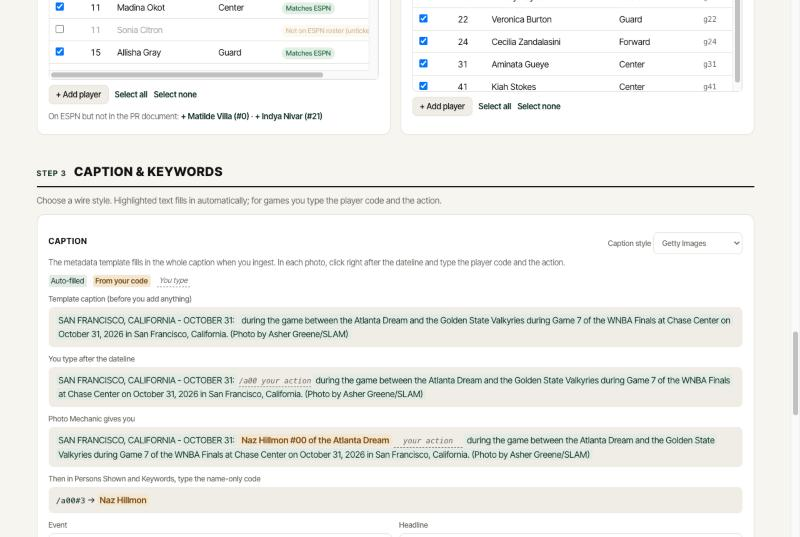
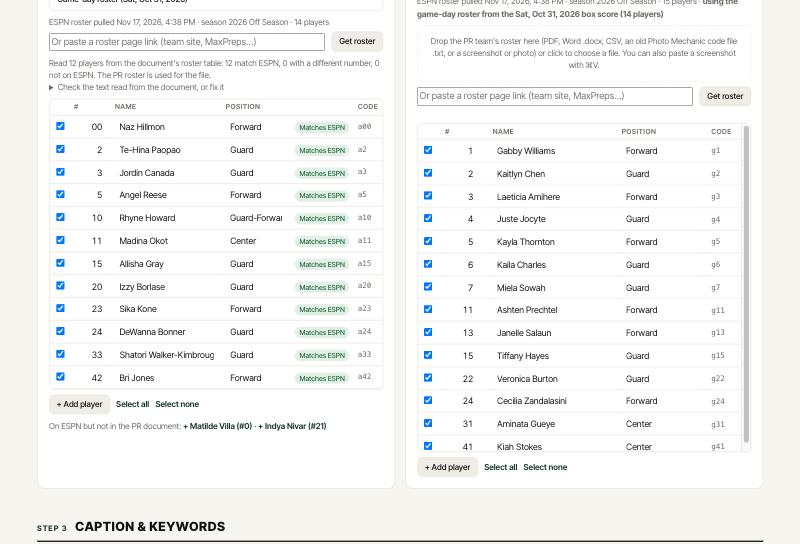

# ASHE Metadata Template Builder

**Caption every shoot in minutes.** Free tools for sports and event photographers who work in Photo Mechanic: a client books the shoot, and the builder turns it into wire-style captions, keywords, roster codes, a metadata template and an ingest file name. Type each fact once; it lands on every photo.

**[Try the demo →](https://ashecrtv.github.io/Metadata-Template-Builder/)** No sign-up. Search a real game and download real templates. Nothing you do there is saved after you close the tab.

Built by Asher Greene, a sports and event photographer in Atlanta ([ashergreenephoto.com](https://ashergreenephoto.com)), for his own photo desk, and shared free.



## What it does

| Page | Who uses it | What it does |
|---|---|---|
| **Builder** (`index.html`) | You | Finds the game on ESPN (or reads a PDF roster), writes the caption in Getty, AP, Imagn, Icon Sportswire or ZUMA style, and gives you the Photo Mechanic files. One click, **Confirm & send to board**, saves the job and shows every download. |
| **Booking** (`booking.html`) | Your clients | A request form: contact, shoot type, event, people to tag, date, venue search and deliverables. Each request gets a reference number (ASHE-001) and emails you. |
| **Job board** (`board.html`) | You (passcode-locked) | Every job in a table, status board or calendar, with its template, file names and gallery link. Syncs across your devices. |
| **Learn** (`learn.html`) | Anyone | Why metadata matters, with a before-and-after search demo. |

**What you download for each shoot**
- **Metadata template (.XMP):** caption, headline, event, location, credit, copyright and keywords, applied on ingest.
- **Ingest file name**, like `20261031_SLAM_ATLvsGSV_AG_` (Photo Mechanic adds the sequence number).
- **Code template** for games: type `/a10/` and get the player's full name and team, for both teams or one.
- **Structured Keywords:** a click-to-add list of league, team, players and actions.

**Also:** crew templates for every photographer on a job, whole-season batch export, roster reading from PDFs, Word, CSV and screenshots, and drafts that arrive on the board when a client books.



## Make your own copy (free)

You get your own builder, booking form and private job board, under your name, with your own data. Nothing is shared with this one.

1. **Fork** this repo on GitHub.
2. In **Netlify** (the free plan works), choose **Add new project → Import from Git**, pick your fork and set the base directory to `website`.
3. Under **Environment variables**, add `BOARD_KEY` with a passcode only you know. That's what locks your job board. Never put it in the code.
4. Under **Forms**, turn on email notifications for the `booking` form, so booking requests reach you.
5. In `website/booking.html`, change `GOOGLE_KEY` to your own Google Places key, restricted to your domain, or set it to `""` to use the free OpenStreetMap address search.
6. Put your own name, links and photos in place of mine (search for "Asher Greene" and "ashergreenephoto").
7. To get updates later, click **Sync fork** on GitHub; Netlify redeploys your copy by itself.

**What stays private:** no passcodes, client data or bookings live in this repo. Your jobs and bookings are stored in your own Netlify account, and the board only opens with your `BOARD_KEY`.

## How it fits together

```
Booking form ──► Job board ──► Builder ──► Photo Mechanic
  (client)       (private)      ▲          XMP template
                                │          Code template
                  Rosters ──────┘          Ingest file name
```

Each page is a single HTML file with no build step. Schedules and rosters come from ESPN's public endpoints and MLB's Stats API, and venue search uses OpenStreetMap.

## License

Code: [MIT](LICENSE), free to use and change. The photos in `website/photos/` are © Asher Greene and aren't covered by the license; please don't reuse them.

Questions or a shoot to book: [ashergreenephoto.com](https://ashergreenephoto.com).
