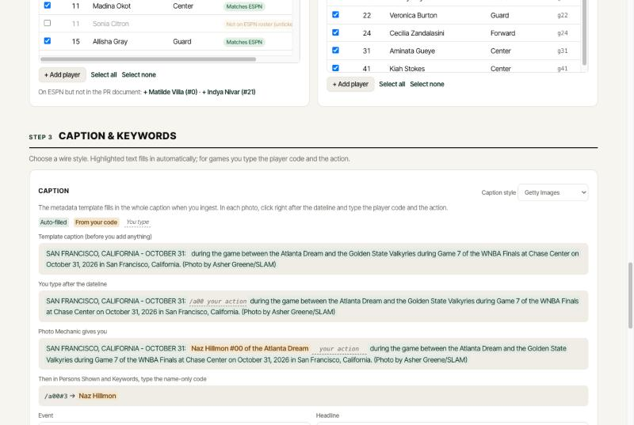
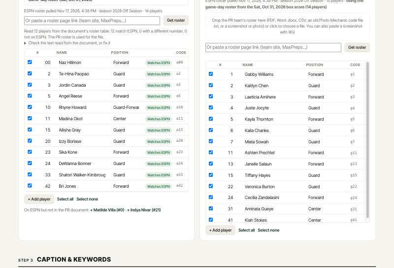

# ASHE Metadata Template Builder

A photo-desk workflow for sports, event and brand photographers who use **Photo Mechanic**. A client's booking turns into wire-style captions, keywords, roster type-in codes and an ingest file name, so each fact is typed once and carried through to every photo.

Built by Asher Greene, an Atlanta sports photographer ([ashergreenephoto.com](https://ashergreenephoto.com)).



## What's in it

| Page | Who uses it | What it does |
|---|---|---|
| `booking.html` | Clients | Request form: contact, shoot type, event, key subjects, date and time, venue search that fills the address, deliverables, preferred photographer. Remembers repeat clients on their device. |
| `index.html` | Photographer | The builder. Finds games on ESPN, reads rosters, writes captions in Getty, AP, Imagn, Icon Sportswire or ZUMA style, and downloads the Photo Mechanic files. |
| `board.html` | Photographer (private) | Job tracker with table, status board and calendar views. Stores each job's gallery link, metadata template and ingest file name. |

## Highlights

- **Five wire caption styles** from the same facts, including AP's position wording and ZUMA's capitalized names.
- **Roster reading in priority order:** the roster table inside a PR PDF or game notes first, then a check against ESPN, then any leftover names shown unticked. Also reads Word, CSV, old code files and screenshots.
- **Photo Mechanic output:** an XMP metadata template (caption, headline, event, location, credit, copyright, keywords), a code replacements file (players, coaches and action phrases), and an ingest file name like `20261031_SLAM_ATLvsGSV_AG_` (Photo Mechanic adds the sequence number).
- **Custom shoots:** events, portraits and brand shoots get a general overview caption; games ESPN doesn't list can be entered by hand.
- **Your own codes:** team code, player prefix and tricode overrides are remembered per team.
- **Phone-friendly.** No build step: each page is a single HTML file.



## How it fits together

```
Booking form ──► Job board ──► Metadata builder ──► Photo Mechanic
 (client)        (private)     ▲                    XMP template
                               │                    Code replacements
                 Rosters ──────┘                    Ingest file name
       (PDF roster table → ESPN → leftovers)
```

## Running it

Open `index.html` in a browser. To use the booking form and roster links online, deploy the folder to Netlify (see `HOW TO PUBLISH.md`); `netlify/functions/roster-page.mjs` fetches public roster pages for the builder.

## Data sources

Schedules and rosters come from ESPN's public endpoints and MLB's Stats API. Venue search uses OpenStreetMap (Photon).
